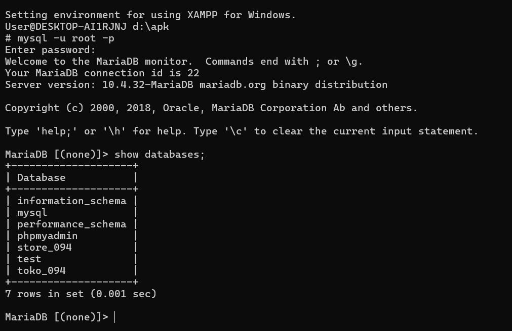
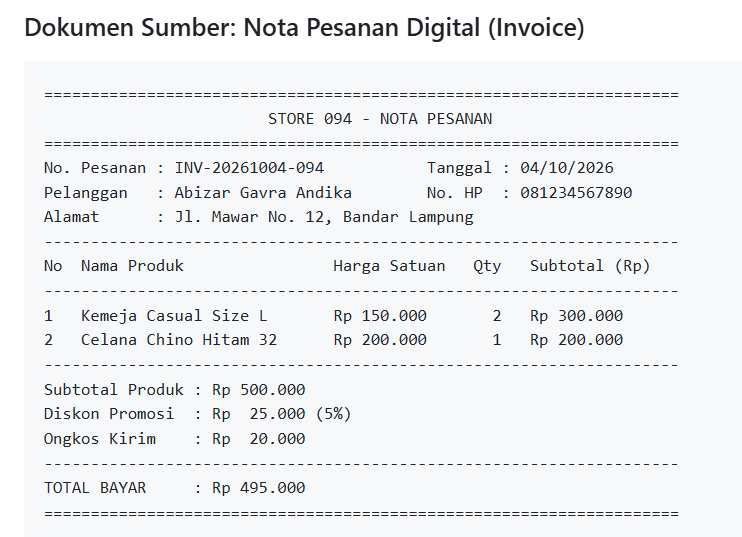

# Laporan Praktikum Basis Data - Pertemuan 02
**Nama:** Abizar Gavra Andika  
**NPM:** 25430094  
**Kelas:** D Ilmu Komputer  
**Tanggal:** 4 Oktober 2026  
**Dosen Pengampu:** Dedi Irawan, S.Kom., M.T.I.  
**Pertemuan:** 2

---

## 1. Tujuan Praktikum
* Memahami tata cara analisis kebutuhan data sekaligus perancangan skema awal basis data pada studi kasus organisasi fiktif.
* Mampu merinci elemen data ke dalam kamus data, menetapkan batasan aturan bisnis, dan memetakan hak akses lewat matriks CRUD.
* Menganalisis batasan non-fungsional serta pemetakan data sensitif atau Personally Identifiable Information (PII) pada sistem.
* Melakukan bedah struktur dokumen fisik/digital (seperti nota belanja) menjadi bentuk entitas relasional.

---

## 2. Ringkasan Dasar Teori
* **Identifikasi Kebutuhan Data:** Langkah awal dalam membedah alur operasional sistem guna menentukan jenis informasi apa saja yang wajib disimpan ke dalam database.
* **Entitas dan Kamus Data:** Entitas berfungsi sebagai wadah penampung data objek, sedangkan kamus data memberikan rincian teknis seperti tipe data, batasan karakter, hingga pihak yang bertanggung jawab atas elemen tersebut.
* **Matriks CRUD:** Pemetaan hak eksekusi data (Create, Read, Update, Delete) yang bertujuan menjaga keandalan serta keamanan data dari perubahan tidak sah.
* **Perlindungan Data Pribadi (PII):** Pengelompokan data bersifat sensitif yang membutuhkan batasan hak akses khusus agar privasi pengguna tetap terjaga.

---

## 3. Hasil Langkah Percobaan

### A. Pengecekan Lingkungan Praktikum

*Keterangan: Pengujian koneksi ke mesin MariaDB lewat Shell XAMPP memakai akun pengguna yang sudah dikonfigurasi pada modul sebelumnya.*

### B. Bedah Dokumen Sumber Nota Pesanan Digital

*Keterangan: Hasil tangkapan layar dokumen sumber Nota Pesanan Digital (Invoice INV-20261004-094) yang digunakan sebagai basis ekstraksi entitas dan atribut basis data.*

---

## 4. Jawaban Titik Analisis
1. **Mengapa entitas transaksi/pesanan tidak boleh diberi akses `Delete` dalam matriks CRUD?**  
   *Jawaban:* Data transaksi memegang peranan krusial untuk urusan audit dan pembukuan keuangan. Apabila record transaksi dihapus, rekapitulasi data akan berantakan dan sulit ditelusuri. Oleh sebab itu, jika ada pembatalan, sistem cukup mengubah tandanya menjadi `Canceled` tanpa menghapus baris datanya.
2. **Mengapa nilai harga pada tabel rincian pesanan dipisah dari tabel master produk?**  
   *Jawaban:* Langkah ini diambil guna mengunci riwayat harga. Jika suatu saat harga di tabel master produk naik atau turun, catatan harga pada transaksi lama yang sudah berhasil tidak ikut berubah.

---

## 5. Hasil Latihan dan Modifikasi
* Menghitung nilai parameter personal $P$ berdasarkan dua angka terakhir NIM ($94 \bmod 9 + 1 = 5$).
* Menetapkan batasan bisnis berupa jumlah belanjaan maksimal $7$ item tiap transaksi ($P+2$) serta batasan diskon harian bernilai $5\%$ ($P$).

---

## 6. Tugas Mandiri: Milestone Proyek 02
Seluruh dokumen analisa kebutuhan data telah disusun pada berkas `p02_kebutuhan_data_25430094.md` dengan poin-poin utama:
* **Proses Bisnis:** Pendaftaran Akun, Pengelolaan Katalog Barang, Transaksi Pembelian, dan Pengiriman Pesanan.
* **Entitas Utama:** `Pelanggan`, `Kategori`, `Produk`, `Pesanan`, `Item_Pesanan`, serta `Pembayaran`.
* **Kamus Data:** Mencakup 20 entri elemen data lengkap beserta spesifikasi tipe dan penanggung jawabnya.
* **Pembedahan Dokumen:** Ekstraksi data dari Nota Pesanan Digital (`INV-20261004-094`) yang tercantum pada Gambar 3.B ke dalam bentuk entitas database (`Pelanggan`, `Pesanan`, `Item_Pesanan`).

---

## 7. Pembahasan dan Kendala
* **Pembahasan:** Pemetaan kebutuhan data berjalan lancar sesuai angka parameter NIM ($P=5$). Rancangan matriks CRUD difokuskan pada perlindungan data keuangan agar tidak mudah diubah secara tidak sah.
* **Kendala:** Sempat agak ragu saat memasukkan rumus parameter ke dalam batasan item belanja dan estimasi transaksi harian.
* **Solusi:** Melakukan kroscek perhitungan nilai $P$ terlebih dahulu sebelum melangkah ke penyusunan kamus data dan aturan bisnis.

---

## 8. Kesimpulan
Melalui praktikum modul kedua ini, saya paham bahwa tahap perancangan dan analisis kebutuhan data sangat krusial sebelum mulai mengetik perintah DDL di SQL. Pembuatan kamus data serta bedah nota transaksi sangat membantu dalam membayangkan calon struktur tabel yang akan dibuat nanti.

---

## 9. Pernyataan Penggunaan AI
Saya menyatakan memanfaatkan AI (Gemini) sebatas kawan diskusi untuk mengecek format penulisan Markdown, memastikan hitungan rumus NIM sudah pas, serta merapikan struktur dokumen. Seluruh pengerjaan dan pemahaman isi laporan ini tetap dilakukan sendiri.

---

## 10. Bukti Git & Keaslian
* **Tautan Repositori:** https://github.com/jik-corder/basisdata_25430094
* **Hash Commit:** `612e745`
* **Pesan Commit:** `p02: Analisis kebutuhan data dan perancangan skema basis data`

---

## Tabel P.13 Checklist Umum Laporan Praktikum

| Check | Butir | Yang Harus Ada |
| :---: | :--- | :--- |
| [x] | **Identitas** | Nama, NIM, kelas, pertemuan ke-2, tanggal pelaksanaan, nama asisten/dosen |
| [x] | **Tujuan** | Tujuan praktikum ditulis ulang dengan bahasa sendiri (maksimal 5 baris) |
| [x] | **Ringkasan Teori** | Pemahaman sendiri atas Dasar Teori, maksimal setengah halaman, tanpa menyalin buku |
| [x] | **Langkah Percobaan (D)** | Tangkapan layar hasil langkah kunci sesuai checklist khusus, masing-masing diberi keterangan singkat |
| [x] | **Titik Analisis** | Semua Titik Analisis dijawab lengkap dengan alasan, bukan sekadar ya/tidak |
| [x] | **Latihan (E)** | Skrip/dokumen hasil latihan beserta bukti berjalan |
| [x] | **Tugas Mandiri (F)** | Milestone proyek pertemuan ini: berkas, bukti, dan penjelasan keputusan desain |
| [x] | **Pembahasan dan Kendala** | Galat yang ditemui, cara membacanya, dan cara mengatasinya |
| [x] | **Kesimpulan** | Dua sampai empat kalimat dengan bahasa sendiri |
| [x] | **Pernyataan Penggunaan AI** | Alat yang dipakai, untuk apa, bagian mana; tulis "tidak menggunakan" bila tidak memakai |
| [x] | **Bukti Git** | Tautan repositori dan kode *commit* (hash) pertemuan ini dengan pesan `p02: ...` |
| [x] | **Keaslian** | Setiap tangkapan layar memperlihatkan akun ber-NIM dan jam sistem; nama objek memuat NIM/inisial |

---

## Checklist Kelengkapan Berkas
- [x] Berkas diberi nama sesuai format `laporan/p02_laporan_25430094.md`
- [x] Struktur laporan sesuai dengan kerangka baku tanpa mengubah urutan bagian
- [x] Parameter $P$ dihitung dengan benar berbasis NIM
- [x] Semua tugas mandiri dan dokumen kebutuhan data telah diselesaikan
- [x] Perubahan telah di-commit dan di-push ke GitHub