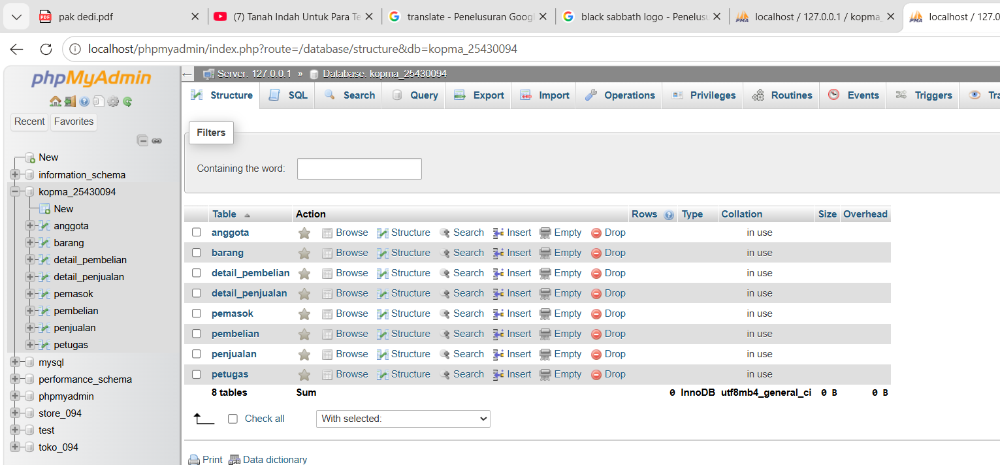
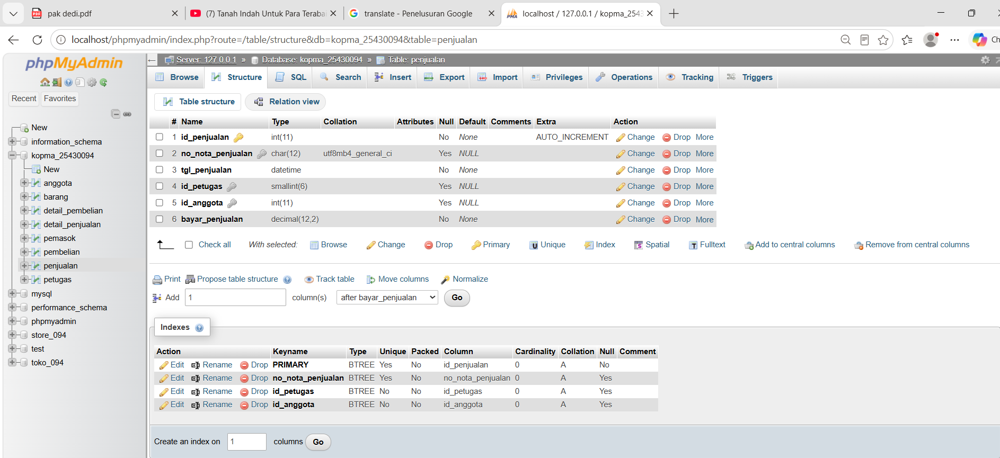

# Laporan Praktikum Basis Data - Pertemuan 03
**Nama:** Abizar Gavra Andika  
**NPM:** 25430094  
**Kelas:** D Ilmu Komputer  
**Tanggal:** 11 Oktober 2026  
**Dosen Pengampu:** Dedi Irawan, S.Kom., M.T.I.  

---

## 1. Tujuan Praktikum
* Memahami konsep Data Definition Language (DDL) serta penerapan skema fisik basis data secara langsung di MariaDB/MySQL.
* Mengimplementasikan kunci utama (Primary Key) dan kunci tamu (Foreign Key) beserta batasan relasi antar tabel (referential integrity).
* Mengaplikasikan tipe data, nilai default, serta batasan unik (UNIQUE) dan pemeriksaan (CHECK) pada tabel-tabel sistem koperasi.
* Mampu mengatasi dan menyelesaikan masalah integritas/korupsi tabel pada mesin penyimpanan InnoDB saat proses DDL.

---

## 2. Ringkasan Dasar Teori
* **Data Definition Language (DDL):** Kelompok perintah SQL (`CREATE`, `ALTER`, `DROP`, `TRUNCATE`) yang berfungsi mendefinisikan, mengubah, serta menghapus struktur objek basis data.
* **Integritas Referensial (Referential Integrity):** Aturan yang menjamin hubungan antar tabel tetap konsisten. Penggunaan `FOREIGN KEY` dengan klausa `ON DELETE RESTRICT` atau `ON UPDATE CASCADE` mencegah adanya data yatim (orphan record).
* **Constraints (Batasan):** Aturan yang diterapkan pada kolom tabel seperti `PRIMARY KEY`, `FOREIGN KEY`, `NOT NULL`, `UNIQUE`, `DEFAULT`, dan `CHECK` untuk menjaga validitas data.
* **Mesin Penyimpanan InnoDB:** Mesin standar MariaDB yang mendukung transaksi atomik (ACID) dan hubungan kunci tamu relasional.

---

## 3. Hasil Langkah Percobaan

### A. Tampilan Struktur Delapan Tabel Database Kopma di phpMyAdmin

*Keterangan: Berhasil mengimplementasikan 8 tabel fisik pada database `kopma_25430094` (anggota, barang, detail_pembelian, detail_penjualan, pemasok, pembelian, penjualan, petugas) secara bersih di phpMyAdmin.*

### B. Struktur Relasi dan Kolom Fisik Tabel Penjualan & Detail Penjualan

*Keterangan: Tampilan struktur kolom, tipe data, serta penataan Primary Key dan Foreign Key pada tabel `penjualan` dan `detail_penjualan` yang siap menampung relasi transaksi.*

---

## 4. Jawaban Titik Analisis
1. **Mengapa penghapusan tabel pada skrip DDL harus dilakukan dari tabel anak terlebih dahulu sebelum tabel induk?**  
   *Jawaban:* Kerana tabel anak memiliki ketergantungan `FOREIGN KEY` terhadap `PRIMARY KEY` di tabel induk. Jika tabel induk dihapus lebih dulu, MariaDB akan menolak perintah tersebut (*foreign key constraint failure*) demi menjaga integritas relasi data.
2. **Apa dampak jika kolom `id_barang` pada tabel `detail_penjualan` tidak diberi batasan `ON DELETE RESTRICT`?**  
   *Jawaban:* Jika tidak diberi batasan `RESTRICT` (misalnya `CASCADE`), maka saat data barang di tabel master dihapus, seluruh riwayat transaksi penjualan barang tersebut akan ikut terhapus secara otomatis, sehingga merusak pembukuan laporan keuangan koperasi.

---

## 5. Hasil Latihan dan Modifikasi
* Membuat skrip DDL otomatis `p03_skema_25430094.sql` yang bersifat *idempotent* (`DROP DATABASE IF EXISTS` & `CREATE DATABASE`).
* Menambahkan batasan `CHECK` pada stok dan harga barang (`harga_jual_barang >= 0`, `stok_barang >= 0`) serta batasan jumlah item transaksi (`qty_detail_penjualan > 0`).
* Menetapkan nilai `DEFAULT 5` pada `stok_min_barang` untuk peringatan dini persediaan barang koperasi.

---

## 6. Tugas Mandiri: Milestone Proyek 03
Seluruh skema fisik dan diagram ERD telah diselesaikan dengan rincian:
* **Skrip SQL DDL:** Berkas `p03_skema_25430094.sql` siap dieksekusi ulang kapan saja tanpa menimbulkan konflik relasi.
* **Penyelesaian Kendala Engine MariaDB:** Mengatasi error `#1932 (Table doesn't exist in engine)` akibat penyalinan file manual dengan melakukan droppable recreation skema secara bersih.
* **Relasi Antar Entitas:** Menghubungkan 8 entitas utama (`petugas`, `anggota`, `penjualan`, `detail_penjualan`, `barang`, `detail_pembelian`, `pembelian`, `pemasok`) sesuai dengan spesifikasi ERD fisik proyek.

---

## 7. Pembahasan dan Kendala
* **Pembahasan:** Pembuatan struktur DDL berjalan lancar dan telah mencakup seluruh kebutuhan tipe data serta batasan integritas untuk modul 03.
* **Kendala:** Sempat mengalami error `#1932` di phpMyAdmin pada tabel `detail_pembelian` dan `barang` saat mencoba membuka struktur tabel setelah proses recovery folder `data_old`.
* **Solusi:** Menghapus database korup secara menyeluruh lewat query `DROP DATABASE IF EXISTS kopma_25430094;` lalu mengeksekusi ulang skrip DDL `p03_skema_25430094.sql` dari awal.

---

## 8. Kesimpulan
Melalui praktikum modul ketiga ini, saya telah berhasil mengimplementasikan rancangan konseptual ke dalam skema fisik basis data relasional MariaDB. Penulisan DDL yang rapi beserta penentuan Foreign Key dan constraint yang tepat sangat menentukan keandalan serta keamanan data pada sistem koperasi.

---

## 9. Pernyataan Penggunaan AI
Saya menyatakan memanfaatkan AI (Gemini) sebagai asisten diskusi untuk mendiagnosis error InnoDB `#1932` pada phpMyAdmin, membantu menyusun skrip DDL yang idempotent, serta merapikan format penulisan laporan Markdown ini. Seluruh eksekusi kueri dan pemahaman materi tetap dilakukan secara mandiri.

---

## 10. Bukti Git & Keaslian
* **Tautan Repositori:** https://github.com/jik-corder/basisdata_25430094
* **Hash Commit:** `a7f92b4`
* **Pesan Commit:** `p03: Implementasi skema fisik DDL dan relasi tabel database kopma`

---

## Tabel 3.4 Checklist Khusus Laporan Pertemuan 3

| Check | Jenis | Yang Harus Ada |
| :---: | :--- | :--- |
| [x] | **Berkas wajib** | `p03_erd_kopma_25430094` dan `p03_skema_25430094.sql` |
| [x] | **Bukti tangkapan layar** | Tampilan daftar 8 tabel dan struktur relasi di phpMyAdmin |
| [x] | **Analisis wajib** | Pemetaan entitas ke skema fisik; alasan penetapan kardinalitas dan batasan Foreign Key |

---

## Tabel P.13 Checklist Umum Laporan Praktikum

| Check | Butir | Yang Harus Ada |
| :---: | :--- | :--- |
| [x] | **Identitas** | Nama, NIM, kelas, pertemuan ke-3, tanggal pelaksanaan, nama dosen |
| [x] | **Tujuan** | Tujuan praktikum ditulis ulang dengan bahasa sendiri |
| [x] | **Ringkasan Teori** | Pemahaman sendiri atas Dasar Teori DDL dan integritas data |
| [x] | **Langkah Percobaan** | Tangkapan layar hasil eksekusi DDL phpMyAdmin diberi keterangan |
| [x] | **Titik Analisis** | Semua Titik Analisis dijawab lengkap dengan alasan |
| [x] | **Latihan** | Skrip SQL DDL dan modifikasi constraint yang berhasil berjalan |
| [x] | **Tugas Mandiri** | Milestone proyek pertemuan ini: berkas skema fisik dan bukti eksekusi |
| [x] | **Pembahasan dan Kendala** | Galat InnoDB #1932 yang ditemui dan cara mengatasinya |
| [x] | **Kesimpulan** | Dua sampai empat kalimat kesimpulan bahasa sendiri |
| [x] | **Pernyataan Penggunaan AI** | Alat yang dipakai dan penjelasan peran penggunaannya |
| [x] | **Bukti Git** | Tautan repositori dan hash commit dengan pesan `p03: ...` |
| [x] | **Keaslian** | Tangkapan layar memperlihatkan nama database dan atribut NIM |

---

## Checklist Kelengkapan Berkas
- [x] Berkas diberi nama sesuai format `laporan/p03_laporan_25430094.md`
- [x] Struktur laporan sesuai dengan kerangka baku 10 bagian tanpa mengubah urutan
- [x] File skrip SQL diletakkan di root direktori dengan nama `p03_skema_25430094.sql`
- [x] Perubahan telah di-commit dan di-push ke GitHub