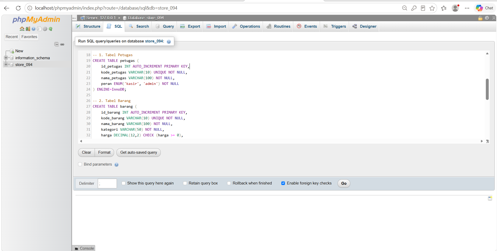
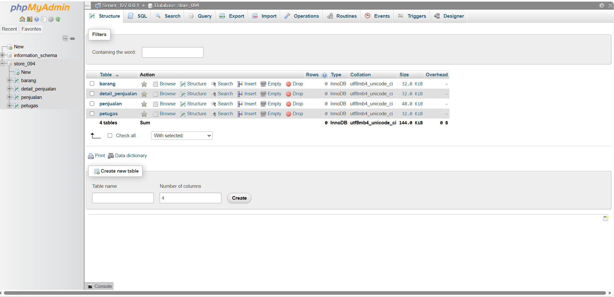
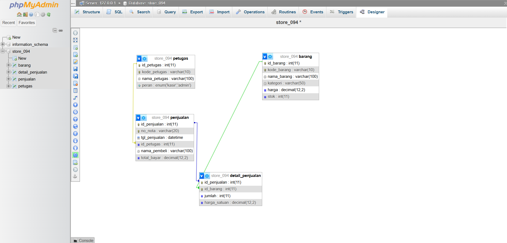

# Laporan Praktikum Basis Data - Pertemuan 03
**Nama:** Abizar Gavra Andika  
**NPM:** 25430094  
**Kelas:** D Ilmu Komputer  
**Tanggal:** 13 Oktober 2026  
**Dosen Pengampu:** Dedi Irawan, S.Kom., M.T.I.  
**Pertemuan:** 3 

---

## 1. Tujuan Praktikum
* Memahami konsep Data Definition Language (DDL) serta penerapan skema fisik basis data secara langsung di MariaDB/MySQL.
* Mengimplementasikan kunci utama (Primary Key) dan kunci tamu (Foreign Key) beserta batasan relasi antar tabel (referential integrity).
* Mengaplikasikan tipe data, nilai default, serta batasan unik (UNIQUE), pemeriksaan (CHECK), dan enumerasi (ENUM) pada sistem toko daring (`store_094`).
* Menerapkan objek basis data lanjutan berupa **Trigger** untuk otomatisasi pembaruan stok barang.
* Mampu mengatasi dan menyelesaikan masalah integritas/korupsi tabel pada mesin penyimpanan saat proses DDL.

---

## 2. Ringkasan Dasar Teori
* **Data Definition Language (DDL):** Kelompok perintah SQL (`CREATE`, `ALTER`, `DROP`, `TRUNCATE`) yang berfungsi mendefinisikan, mengubah, serta menghapus struktur objek basis data.
* **Integritas Referensial (Referential Integrity):** Aturan yang menjamin hubungan antar tabel tetap konsisten. Penggunaan `FOREIGN KEY` dengan klausa `ON DELETE RESTRICT` atau `ON UPDATE CASCADE` mencegah adanya data yatim (*orphan record*).
* **Constraints (Batasan):** Aturan yang diterapkan pada kolom tabel seperti `PRIMARY KEY`, `FOREIGN KEY`, `NOT NULL`, `UNIQUE`, `DEFAULT`, dan `CHECK` untuk menjaga validitas data.
* **Trigger:** Objek prosedur tersimpan yang otomatis berjalan (*fired*) ketika terjadi peristiwa manipulasi data (`INSERT`, `UPDATE`, `DELETE`) pada tabel tertentu.

---

## 3. Hasil Langkah Percobaan

### A. Kueri Skrip DDL SQL pada Tab SQL phpMyAdmin Sebelum Dieksekusi

*Keterangan: Tampilan penulisan kueri skrip DDL lengkap untuk pembuatan 4 tabel utama (`petugas`, `barang`, `penjualan`, `detail_penjualan`) beserta constraint dan trigger pada tab SQL phpMyAdmin sebelum tombol Go ditekan.*

### B. Tampilan Struktur Empat Tabel Database Store di phpMyAdmin

*Keterangan: Berhasil mengimplementasikan 4 tabel fisik utama pada database `store_094` secara bersih di phpMyAdmin.*

### C. Visualisasi ERD & Hubungan Relasi (Designer)

*Keterangan: Tampilan diagram relasi entitas (ERD) yang memperlihatkan kardinalitas 1:N antara Petugas-Penjualan dan Penjualan-Detail Penjualan-Barang.*

---

## 4. Jawaban Titik Analisis
1. **Mengapa penghapusan tabel pada skrip DDL harus dilakukan dari tabel anak terlebih dahulu sebelum tabel induk?**  
   *Jawaban:* Karena tabel anak memiliki ketergantungan `FOREIGN KEY` terhadap `PRIMARY KEY` di tabel induk. Jika tabel induk dihapus lebih dulu, MariaDB akan menolak perintah tersebut (*foreign key constraint failure*) demi menjaga integritas relasi data.
2. **Apa dampak jika kolom `id_barang` pada tabel `detail_penjualan` tidak diberi batasan `ON DELETE RESTRICT`?**  
   *Jawaban:* Jika tidak diberi batasan `RESTRICT` (misalnya `CASCADE`), maka saat data barang di tabel master dihapus, seluruh riwayat transaksi penjualan barang tersebut akan ikut terhapus secara otomatis, sehingga merusak rekapitulasi laporan penjualan toko.

---

## 5. Latihan dan Modifikasi
1. **Analisis Atribut Poin Loyalitas:**  
   Poin loyalitas cukup diletakkan sebagai atribut tambahan pada entitas pelanggan/anggota jika sistem hanya membutuhkan informasi sisa total poin terkini secara ringkas. Namun, jika sistem memerlukan rekam jejak audit (perolehan poin dari transaksi dan penukaran poin secara historis), maka diperlukan entitas terpisah yaitu `riwayat_poin` yang berelasi 1:N dengan pelanggan. Untuk proyek toko daring sederhana (`store_094`), penggunaan atribut langsung pada entitas utama sudah memadai.
2. **Dampak Penghapusan Entitas Asosiatif pada Relasi Penjualan-Barang:**  
   Jika relasi antara `PENJUALAN` dan `BARANG` diubah langsung menjadi Banyak-ke-Banyak (M:N) tanpa entitas asosiatif (`detail_penjualan`), maka **data spesifik transaksi per item akan hilang**, yaitu:
   * Jumlah barang (`jumlah` / qty) yang dibeli pada suatu nota tidak dapat disimpan.
   * Harga satuan barang saat transaksi terjadi tidak terekam, sehingga sistem akan selalu mengambil harga master terbaru dan merusak keakuratan historis laporan keuangan.

---

## 6. Tugas Mandiri: Milestone Proyek 03
* **Berkas ERD Proyek:** Disimpan dalam berkas `p03_erd_25430094.drawio` dan diekspor ke format gambar `img/p03_erd_25430094.png`.
* **Tabel Relasi dan Kardinalitas (Aturan Bisnis):**
  | Kode AB | Entitas 1 | Kardinalitas | Entitas 2 | Deskripsi Aturan Bisnis |
  | :--- | :--- | :---: | :--- | :--- |
  | **AB-01** | `PETUGAS` | `1 : N` | `PENJUALAN` | Satu petugas (kasir/admin) melayani banyak transaksi penjualan, tetapi satu penjualan ditangani oleh satu petugas. |
  | **AB-02** | `PENJUALAN` | `1 : N` | `DETAIL_PENJUALAN` | Satu nota penjualan mencakup satu atau banyak rincian item barang. |
  | **AB-03** | `BARANG` | `1 : N` | `DETAIL_PENJUALAN` | Satu jenis barang dapat dibeli dalam berbagai transaksi penjualan melalui entitas asosiatif. |

* **Tabel Penelusuran KI → Jalur ERD:**
  | Kode KI | Kebutuhan Informasi | Jalur Entitas pada ERD | Keterangan Jalur |
  | :--- | :--- | :--- | :--- |
  | **KI-01** | Rekapitulasi total penjualan berdasarkan petugas kasir | `PETUGAS` $\rightarrow$ `PENJUALAN` | Menelusuri kinerja dan tanggung jawab transaksi kasir. |
  | **KI-02** | Rincian detail barang, jumlah, dan subtotal per nota | `PENJUALAN` $\rightarrow$ `DETAIL_PENJUALAN` $\rightarrow$ `BARANG` | Menampilkan item barang dan rincian harga pada struk belanja. |

* **Entitas Asosiatif:** `DETAIL_PENJUALAN` dengan atribut sendiri yaitu `jumlah` (qty) dan `harga_satuan`.
* **Standar Kelengkapan ERD Konseptual:** Memenuhi seluruh komponen entitas utama, atribut kunci, kardinalitas, partisipasi, dan batasan integritas relasional.
* **Catatan Tinjauan Klien (Umpan Balik Rekan Sejawat):**
  1. *Rian (NPM 25430012):* "Skema awal terlalu rumit untuk skala toko daring sederhana, sebaiknya difokuskan pada kasir dan penjualan saja." $\rightarrow$ **Keputusan:** Diterima dan disederhanakan menjadi 4 tabel utama (`petugas`, `barang`, `penjualan`, `detail_penjualan`).
  2. *Siti (NPM 25430045):* "Tambahkan nilai default untuk pelanggan umum jika pembeli tidak tercatat sebagai anggota tetap." $\rightarrow$ **Keputusan:** Diterima dengan menambahkan klausa `DEFAULT 'Pelanggan Umum'` pada tabel `penjualan`.

---

## 7. Pembahasan dan Kendala
* **Pembahasan:** Pembuatan struktur DDL 4 tabel dan objek Trigger berjalan lancar. Seluruh tipe data, constraint, serta foreign key berfungsi dengan baik tanpa kendala integritas.
* **Kendala:** Sempat mengalami masalah galat penyimpanan sistem Aria/InnoDB saat pemulihan sesi akses *privileges* lokal.
* **Solusi:** Melakukan perbaikan tabel sistem menggunakan perintah `mysqlcheck` dan menyesuaikan kembali hak akses (*GRANT*) user lokal.

---

## 8. Kesimpulan
Melalui praktikum modul ketiga ini, saya telah berhasil merancang dan mengimplementasikan skema fisik basis data relasional ke dalam MariaDB untuk sistem toko daring (`store_094`). Penggunaan 4 tabel utama yang didukung oleh *constraints*, *Foreign Key*, serta *Trigger* terbukti membuat sistem lebih ringkas, efisien, dan andal dalam menjaga konsistensi data.

---

## 9. Pernyataan Penggunaan AI
Saya menyatakan memanfaatkan AI (Gemini) sebagai asisten diskusi untuk mendiagnosis kendala koneksi tabel sistem, membantu merancang struktur DDL ringkas 4 tabel, pembuatan trigger otomatisasi stok, serta merapikan format laporan Markdown ini. Seluruh eksekusi kueri dan pemahaman materi tetap dilakukan secara mandiri.

---

## 10. Bukti Git & Keaslian
* **Tautan Repositori:** https://github.com/jik-corder/basisdata_25430094
* **Hash Commit:** *(sesuaikan setelah commit git push)*
* **Pesan Commit:** `docs(modul3): menambahkan screenshot kueri ddl sql pada laporan p03`

---

## Tabel 3.4 Checklist Khusus Laporan Pertemuan 3

| Check | Jenis | Yang Harus Ada |
| :---: | :--- | :--- |
| [x] | **Berkas wajib** | `p03_erd_25430094` dan `p03_skema_25430094.sql` |
| [x] | **Bukti tangkapan layar** | Kueri SQL DDL, tampilan daftar 4 tabel, dan struktur relasi di phpMyAdmin |
| [x] | **Analisis wajib** | Pemetaan entitas ke skema fisik; alasan penetapan kardinalitas dan batasan Foreign Key |

---

## Tabel P.13 Checklist Umum Laporan Praktikum

| Check | Butir | Yang Harus Ada |
| :---: | :--- | :--- |
| [x] | **Identitas** | Nama, NIM, kelas, pertemuan ke-3, tanggal pelaksanaan, nama dosen |
| [x] | **Tujuan** | Tujuan praktikum ditulis ulang dengan bahasa sendiri |
| [x] | **Ringkasan Teori** | Pemahaman sendiri atas Dasar Teori DDL dan integritas data |
| [x] | **Langkah Percobaan** | Tangkapan layar hasil eksekusi DDL phpMyAdmin diberi keterangan |
| [x] | **Titik Analisis** | Semua Titik Analisis dijawab lengkap dengan alasan |
| [x] | **Latihan** | Skrip SQL DDL dan modifikasi constraint yang berhasil berjalan |
| [x] | **Tugas Mandiri** | Milestone proyek pertemuan ini: berkas skema fisik dan bukti eksekusi |
| [x] | **Pembahasan dan Kendala** | Kendala galat sistem dan cara mengatasinya |
| [x] | **Kesimpulan** | Dua sampai empat kalimat kesimpulan bahasa sendiri |
| [x] | **Pernyataan Penggunaan AI** | Alat yang dipakai dan penjelasan peran penggunaannya |
| [x] | **Bukti Git** | Tautan repositori dan hash commit |
| [x] | **Keaslian** | Tangkapan layar memperlihatkan nama database dan atribut NIM |

---

## Checklist Kelengkapan Berkas
- [x] Berkas diberi nama sesuai format `laporan/p03_laporan_25430094.md`
- [x] Struktur laporan sesuai dengan kerangka baku 10 bagian tanpa mengubah urutan
- [x] File skrip SQL diletakkan di root direktori dengan nama `p03_skema_25430094.sql`
- [x] Perubahan telah di-commit dan di-push ke GitHub