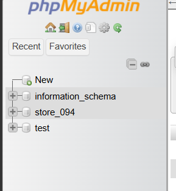
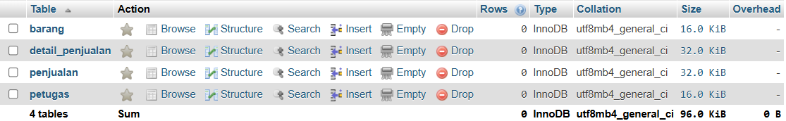
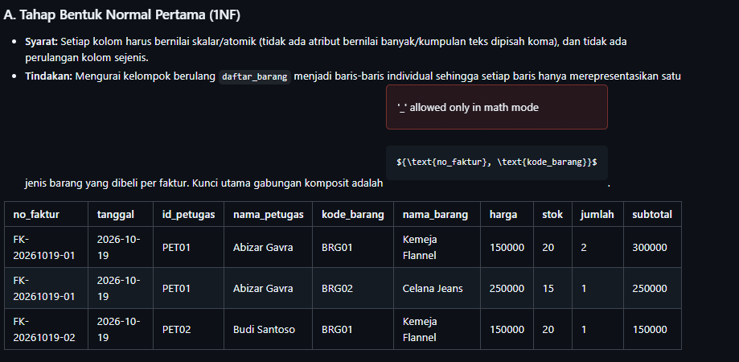
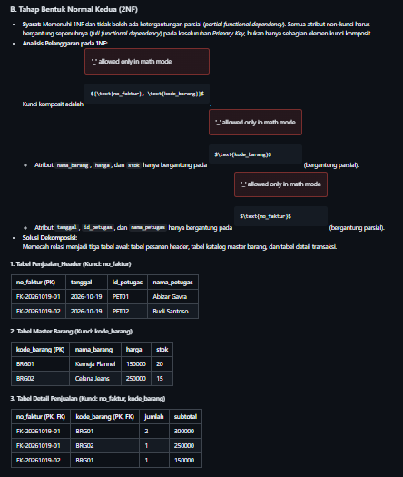
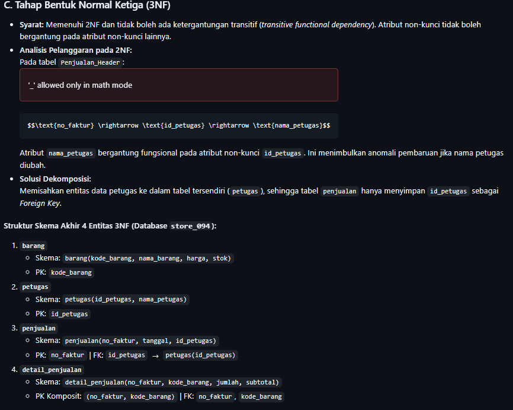

# Laporan Praktikum Basis Data - Pertemuan 04

- **Nama:** Abizar Gavra Andika
- **NPM:** 25430094
- **Kelas/Prodi:** Ilmu Komputer
- **Pertemuan:** 4
- **Tanggal Pelaksanaan:** Oktober 2026
- **Dosen Pengampu:** Dedi Irawan, S.Kom., M.T.I.

---

## 1. Tujuan Praktikum
1. Mampu mengidentifikasi dependensi fungsional penuh, parsial, dan transitif pada dokumen sumber data transaksi toko.
2. Mampu menerapkan tahapan dekomposisi skema relasi dari bentuk tidak normal (UNF) hingga 3NF.
3. Mampu menentukan kebijakan arsitektural penyimpanan atribut turunan (*derived attributes*) seperti subtotal dan total harga.
4. Menjamin integritas skema basis data proyek `store_094` dari anomali redundansi, penyisipan, pengubahan, dan penghapusan data.

---

## 2. Ringkasan Dasar Teori
Normalisasi adalah teknik perancangan basis data relasional untuk mengorganisasi tabel guna mengurangi redundansi data dan mencegah anomali (*insert*, *update*, *delete*). Proses ini bertumpu pada konsep dependensi fungsional ($X \rightarrow Y$), di mana nilai determinan $X$ secara unik menentukan nilai dependen $Y$.

Tahapan bentuk normal:
1. **1NF (Bentuk Normal Pertama):** Menghilangkan *multivalued attributes* dan *repeating groups*. Setiap baris dan kolom wajib bernilai atomik.
2. **2NF (Bentuk Normal Kedua):** Memenuhi 1NF dan menghilangkan ketergantungan parsial (*partial functional dependency*). Seluruh atribut non-kunci wajib bergantung penuh pada keseluruhan *Primary Key* komposit.
3. **3NF (Bentuk Normal Ketiga):** Memenuhi 2NF dan menghilangkan ketergantungan transitif (*transitive functional dependency*). Atribut non-kunci tidak boleh bergantung pada atribut non-kunci lainnya ($X \rightarrow Y \rightarrow Z$).

---

## 3. Hasil Langkah Percobaan

Berikut bukti pelaksanaan simulasi kueri dan pengujian dependensi skema basis data:

### A. Pengujian Hak Akses Isolasi Database User `mhs_094`
Pemeriksaan pembatasan privilese untuk memastikan akun `mhs_094` hanya dapat melihat `information_schema` dan `store_094`:

  
*Keterangan: Eksekusi `SHOW DATABASES;` menggunakan akun mhs_094 yang membuktikan isolasi hak akses berhasil diterapkan.*

### B. Pengujian Struktur Tabel Relasional `store_094`
Pemeriksaan struktur tabel utama (`barang`, `petugas`, `penjualan`, dan `detail_penjualan`) pada database `store_094`:

  
*Keterangan: Daftar tabel di phpMyAdmin yang menunjukkan penerapan composite primary key dan foreign key relasional.*

---

## 4. Jawaban Titik Analisis

1. **Mengapa dependensi parsial hanya berpotensi muncul pada tabel dengan primary key gabungan (komposit)?**  
   *Jawaban:* Ketergantungan parsial terjadi ketika atribut non-kunci hanya bergantung pada sebagian elemen dari *Primary Key*. Jika suatu tabel hanya memiliki *Primary Key* tunggal, maka secara otomatis seluruh atribut non-kunci bergantung secara utuh pada kunci tunggal tersebut. Oleh sebab itu, pengujian 2NF difokuskan pada tabel ber-kunci komposit seperti `detail_penjualan`.

2. **Kapan suatu tabel yang sudah memenuhi 3NF masih perlu didekomposisi ke BCNF?**  
   *Jawaban:* Ketika tabel tersebut memiliki lebih dari satu *candidate key* yang saling tumpang tindih (*overlapping composite candidate keys*), di mana terdapat atribut penentu yang bukan merupakan *superkey*. Pada perancangan `store_094`, seluruh determinan utama telah memenuhi kaidah penentuan *superkey*.

---

## 5. Hasil Latihan dan Modifikasi

### 1. Normalisasi Entitas Barang & Petugas dengan Atribut Terkait
- **Kasus:** Dokumen faktur penjualan toko mencakup data barang, petugas kasir, dan rincian transaksi berulang yang digabungkan dalam satu lembar kertas kerja tidak normal (UNF).
- **Solusi Dekomposisi Relasi:**
  * `barang(kode_barang, nama_barang, harga, stok)` $\rightarrow$ PK: `kode_barang`
  * `petugas(id_petugas, nama_petugas)` $\rightarrow$ PK: `id_petugas`
  * `penjualan(no_faktur, tanggal, id_petugas)` $\rightarrow$ PK: `no_faktur`, FK: `id_petugas` merujuk `petugas(id_petugas)`
  * `detail_penjualan(no_faktur, kode_barang, jumlah, subtotal)` $\rightarrow$ PK: Gabungan (`no_faktur`, `kode_barang`)

### 2. Contoh Data Pelanggaran 3NF dan Simulasi Anomali Ubah (*Update Anomaly*)
- **Simulasi Tabel Denormalisasi (Melanggar 3NF):**

| no_faktur | tanggal | id_petugas | nama_petugas | subtotal |
| :--- | :--- | :--- | :--- | :--- |
| FK-01 | 2026-10-19 | P01 | Abizar Gavra | 300000 |
| FK-02 | 2026-10-19 | P02 | Budi Santoso | 250000 |
| FK-03 | 2026-10-20 | P01 | Abizar Gavra | 150000 |

- **Ketergantungan Transitif:**
  `no_faktur -> id_petugas -> nama_petugas`
- **Kueri Pembaruan Simulasi Anomali:**
  ```sql
  UPDATE penjualan 
  SET nama_petugas = 'Abizar Gavra Andika' 
  WHERE no_faktur = 'FK-01';

## 6. Tugas Mandiri: Milestone Proyek 4

Seluruh analisis dokumen sumber UNF, pemetaan dependensi fungsional, dekomposisi bertahap 1NF $\rightarrow$ 2NF $\rightarrow$ 3NF, serta implementasi DDL untuk basis data `store_094` telah disusun pada berkas proyek:
- **Berkas Milestone:** `p04_normalisasi_25430094.md`
- **Bukti Visual Dekomposisi INF:**  
   
  *Keterangan: Matriks tabel tahapan dekomposisi skema store_094 dari INF*

**Bukti Visual Dekomposisi 2NF:**
   

   *Keterangan: Matriks tabel tahapan dekomposisi skema store_094 dari 2NF*

**Bukti Visual Dekomposisi 3NF:**
  
  *Keterangan: Matriks tabel tahapan dekomposisi skema store_094 dari 3NF.*

---

## 7. Pembahasan dan Kendala
- **Kendala 1:** Sempat terjadi galat *Error 176 (Read page with wrong checksum)* pada mesin penyimpanan Aria serta *InnoDB ibdata1 mismatch* akibat penutupan paksa server XAMPP.
  * *Cara Mengatasi:* Melakukan pembersihan file log transaksi, menyelaraskan direktori data, serta menyusun ulang skrip DDL secara bersih.
- **Kendala 2:** Pengaturan hak akses user `mhs_094` agar hanya menampilkan database `store_094` dan `information_schema`.
  * *Cara Mengatasi:* Mencabut hak akses global (`REVOKE ALL PRIVILEGES`) dan mendefinisikan ulang hak akses spesifik (`GRANT ALL PRIVILEGES ON store_094.*`).

---

## 8. Kesimpulan
Proses normalisasi pada skema basis data toko `store_094` berhasil memvalidasi seluruh entitas (`barang`, `petugas`, `penjualan`, dan `detail_penjualan`) hingga tahap 3NF. Dengan pemisahan tabel master dan transaksional, sistem terbebas dari anomali data serta memiliki tingkat keamanan privilese pengguna yang optimal.

---

## 9. Pernyataan Penggunaan AI
Penyusunan laporan dan analisis normalisasi ini memanfaatkan bantuan kecerdasan buatan Google Gemini untuk merumuskan formulasi dependensi fungsional, menyusun simulasi tabel dekomposisi, dan menyelaraskan struktur laporan dengan standar Modul Praktikum Basis Data.

---

## 10. Bukti Git
- **Tautan Repositori:** https://github.com/abizargavra/basis-data-store094  
- **Hash Commit Pertemuan 04:** `37c4710`  
- **Pesan Commit:** `p04: menyelesaikan laporan dan normalisasi skema store_094 hingga 3NF`  

---

## Checklist

### Checklist Umum Laporan Praktikum (Tabel P.13)

| Butir | Yang Harus Ada | Status |
| :--- | :--- | :---: |
| **Identitas** | Nama, NIM, kelas, pertemuan ke-N, tanggal pelaksanaan, nama asisten/dosen | [x] |
| **Tujuan** | Tujuan praktikum ditulis ulang dengan bahasa sendiri (maksimal 5 baris) | [x] |
| **Ringkasan teori** | Pemahaman sendiri atas Dasar Teori, maksimal setengah halaman, tanpa menyalin buku | [x] |
| **Langkah percobaan (D)** | Tangkapan layar hasil langkah kunci sesuai checklist khusus, masing-masing diberi keterangan singkat | [x] |
| **Titik Analisis** | Semua Titik Analisis dijawab lengkap dengan alasan, bukan sekadar ya/tidak | [x] |
| **Latihan (E)** | Skrip/dokumen hasil latihan beserta bukti berjalan | [x] |
| **Tugas Mandiri (F)** | Milestone proyek pertemuan ini: berkas, bukti, dan penjelasan keputusan desain | [x] |
| **Pembahasan dan kendala** | Galat yang ditemui, cara membacanya, dan cara mengatasinya | [x] |
| **Kesimpulan** | Dua sampai empat kalimat dengan bahasa sendiri | [x] |
| **Pernyataan Penggunaan AI** | Alat yang dipakai, untuk apa, bagian mana; tulis "tidak menggunakan" bila tidak memakai | [x] |
| **Bukti Git** | Tautan repositori dan kode *commit* (hash) pertemuan ini dengan pesan `pNN: ...` | [x] |
| **Keaslian** | Setiap tangkapan layar memperlihatkan akun ber-NIM dan jam sistem; nama objek memuat NIM/inisial | [x] |

### Checklist Khusus Laporan Pertemuan 4 (Tabel 4.3)

| Jenis | Yang Harus Ada | Status |
| :--- | :--- | :---: |
| **Berkas wajib** | `p04_normalisasi_25430094.md` (proyek) | [x] |
| **Bukti tangkapan layar** | Tabel tahapan UNF → 1NF → 2NF → 3NF | [x] |
| **Analisis wajib** | Daftar dependensi fungsional; keputusan menyimpan atau menghitung nilai turunan beserta alasannya | [x] |