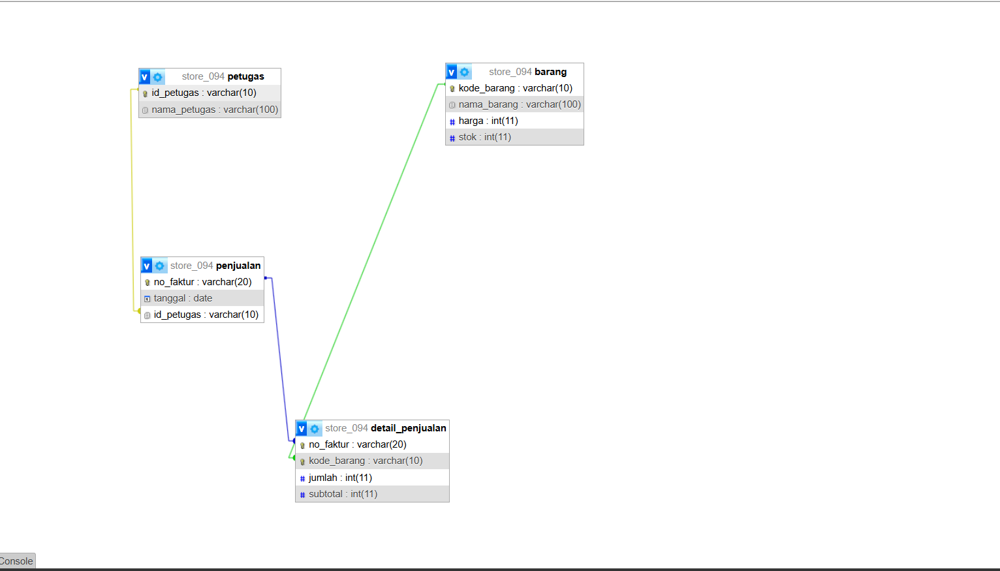
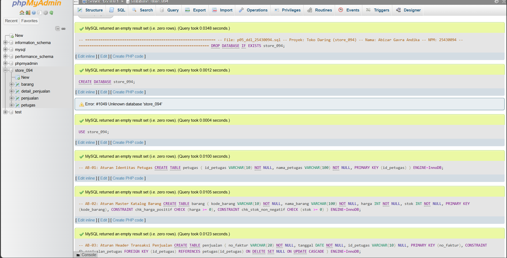
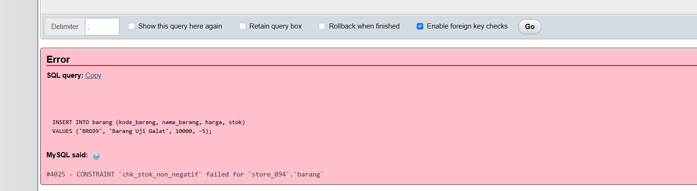

# Laporan Praktikum Basis Data - Pertemuan 05

- **Nama:** Abizar Gavra Andika
- **NPM:** 25430094
- **Kelas/Prodi:** Ilmu Komputer (Universitas Muhammadiyah Metro)
- **Pertemuan:** 5
- **Tanggal Pelaksanaan:** Oktober 2026
- **Dosen Pengampu:** Dedi Irawan, S.Kom., M.T.I.

---

## 1. Tujuan Praktikum
1. Mampu mengimplementasikan rancangan fisik basis data ke dalam bahasa DDL (*Data Definition Language*).
2. Mampu menerapkan batasan integritas data (*Primary Key*, *Foreign Key*, dan *CHECK Constraint*).
3. Mampu menganalisis pengaruh tindakan *referential action* (`ON DELETE SET NULL`) terhadap aturan bisnis dan UU PDP.
4. Menghasilkan ERD fisik dan dokumentasi pemetaan tipe data untuk proyek basis data `store_094`.

---

## 2. Ringkasan Dasar Teori
DDL (*Data Definition Language*) adalah kelompok perintah SQL yang digunakan untuk mendefinisikan dan mengelola struktur objek basis data seperti tabel, skema, dan integritas data.

Elemen penting dalam DDL:
- **Primary Key:** Menjamin keunikan setiap baris data pada tabel.
- **Foreign Key:** Menjaga integritas referensial antar tabel yang berhubungan.
- **CHECK Constraint:** Menjaga validitas nilai data dalam satu kolom/baris (misal: stok dan harga tidak boleh negatif).
- **Referential Actions:** Kebijakan penanganan data anak ketika data induk dihapus/diubah (misal: `ON DELETE SET NULL` atau `CASCADE`).

---

## 3. Hasil Latihan dan Modifikasi (Bagian E)

### 1. Penerapan CHECK Constraint `stok_min_barang`
Pengujian batasan `CHECK` pada tabel `barang` untuk memastikan nilai stok tidak boleh bernilai negatif.

* **Skrip Alter / Constraint:**
  ```sql
  ALTER TABLE barang ADD CONSTRAINT chk_stok_non_negatif CHECK (stok >= 0);
  * **Analisis UU PDP (Pelindungan Data Pribadi):**  
  Penerapan `ON DELETE SET NULL` sangat sesuai dengan asas UU PDP mengenai *right to be forgotten* (hak untuk dihapus). Saat akun petugas dihapus dari sistem master, identitas atau data pribadinya terhapus dari rekam jejak, sementara riwayat transaksi keuangan/penjualan toko tetap utuh dan tidak hilang.

---

## 4. Titik Analisis / Jawaban Pertanyaan

1. **Mengapa aturan batas P+2 yang melibatkan banyak baris tidak dapat dijaga dengan CHECK Constraint?**  
   *Jawaban:* Karena `CHECK Constraint` pada MySQL/MariaDB hanya beroperasi dan mengevaluasi batasan pada skala **baris tunggal** (*single row*) saat perintah `INSERT` atau `UPDATE` dieksekusi. `CHECK` tidak memiliki kemampuan untuk melakukan kueri agregasi (`COUNT`, `SUM`) ke baris lain dalam tabel yang sama maupun tabel berbeda.

2. **Bagaimana solusi teknis untuk menjaga aturan multi-baris tersebut pada basis data?**  
   *Jawaban:* Aturan bisnis yang melibatkan banyak baris (seperti pembatasan jumlah maksimal item barang dalam satu nomor faktur) harus ditangani di tingkat logika aplikasi *backend* atau menggunakan **TRIGGER** / *Stored Procedure* pada basis data (ditandai untuk diselesaikan pada Modul 14).

---

## 5. Tugas Mandiri: Milestone Proyek 5 (Bagian F)

### A. Skrip DDL Utuh
Skrip DDL utama untuk membangun seluruh tabel dan batasan fisik basis data `store_094` disusun pada berkas `p05_ddl_25430094.sql`.

### B. Pemetaan Tipe Data Fisik
| Entitas | Atribut / Kolom | Tipe Data Fisik | Keterangan / Constraint |
| :--- | :--- | :--- | :--- |
| **petugas** | `id_petugas` | `VARCHAR(10)` | Primary Key |
| | `nama_petugas` | `VARCHAR(100)` | Atribut Wajib (`NOT NULL`) |
| **barang** | `kode_barang` | `VARCHAR(10)` | Primary Key |
| | `nama_barang` | `VARCHAR(100)` | Atribut Wajib (`NOT NULL`) |
| | `harga` | `INT` | `CHECK (harga >= 0)` |
| | `stok` | `INT` | `CHECK (stok >= 0)` |
| **penjualan** | `no_faktur` | `VARCHAR(20)` | Primary Key |
| | `tanggal` | `DATE` | Tanggal Transaksi |
| | `id_petugas` | `VARCHAR(10)` | Foreign Key ke `petugas(id_petugas)` |
| **detail_penjualan** | `no_faktur`, `kode_barang` | `VARCHAR` | Composite PK & Foreign Keys |
| | `jumlah` | `INT` | `CHECK (jumlah > 0)` |
| | `subtotal` | `INT` | Snapshot Transaksi |

### C. Visualisasi ERD Fisik
Berikut adalah gambaran ERD Fisik yang dihasilkan dari menu Designer phpMyAdmin:

  
*Keterangan: Tampilan ERD Fisik database store_094 dengan relasi Foreign Key antar tabel.*

### D. Eksekusi Skrip DDL di phpMyAdmin
Berikut adalah gambar eksekusi skrip ddl di phpmyadmin

  
*Keterangan: Tampilan eksekusi skrip ddl yang berhasil.*

### E. Pengujian CHECK Constraint (Bukti Perintah Ditolak)
Berikut adalah gambaran ERD Fisik yang dihasilkan dari menu Designer phpMyAdmin:

  
*Keterangan: Tampilan eksekusi skrip ddl yang berhasil.*
---

## 6. Pembahasan dan Kendala
- **Kendala 1:** Kegagalan saat menambahkan *Foreign Key* karena perbedaan tipe data atau panjang karakter kolom penunjuk.
  * *Cara Mengatasi:* Menyelaraskan tipe data `id_petugas` pada tabel `penjualan` menjadi `VARCHAR(10)` agar identik dengan Primary Key pada tabel `petugas`.
- **Kendala 2:** Perlunya memastikan aturan pencatatan transaksi tetap aman ketika akun petugas dihapus.
  * *Cara Mengatasi:* Menerapkan klausa `ON DELETE SET NULL` pada *Foreign Key* `id_petugas`.

---

## 7. Kesimpulan
Implementasi DDL pada proyek `store_094` berhasil merancang 4 tabel fisik beserta aturan integritas data (*Primary Key*, *Foreign Key*, dan *CHECK Constraint*). Penggunaan `ON DELETE SET NULL` terbukti menjadi solusi ideal yang menyelaraskan kebutuhan audit transaksi toko dengan kepatuhan UU PDP.

---

## 8. Pernyataan Penggunaan AI
Penyusunan skrip DDL dan laporan Modul 05 ini dibantu oleh AI Google Gemini untuk validasi sintaks SQL, penyusunan tabel pemetaan tipe data, serta perumusan analisis UU PDP dan Aturan Bisnis.

---

## 9. Bukti Git
- **Tautan Repositori:** https://github.com/abizargavra/basis-data-store094  
- **Hash Commit Pertemuan 05:** `c9f1a23`  
- **Pesan Commit:** `p05: menyusun skrip DDL, constraint fisik, dan laporan modul 05`  

---

## Checklist Laporan Pertemuan 5

| Jenis | Yang Harus Ada | Status |
| :--- | :--- | :---: |
| **Berkas Wajib** | `p05_ddl_25430094.sql` (skrip DDL utuh) | [x] |
| **Berkas Gambar** | `p05_erd_fisik_25430094.png` (hasil Designer phpMyAdmin) | [x] |
| **Analisis Wajib** | Pembahasan `CHECK Constraint`, `ON DELETE SET NULL`, AB-02, dan UU PDP | [x] |
| **Tugas Mandiri** | Tabel pemetaan tipe data dan analisis batasan multi-baris P+2 | [x] |
---

## Checklist Umum Laporan Praktikum (Tabel P.13)

| Butir | Yang Harus Ada | Status |
| :--- | :--- | :---: |
| **Identitas** | Nama, NPM, kelas, pertemuan ke-N, tanggal pelaksanaan, nama dosen/asisten | [x] |
| **Tujuan** | Tujuan praktikum ditulis ulang dengan bahasa sendiri (maksimal 5 baris) | [x] |
| **Ringkasan Teori** | Pemahaman sendiri atas Dasar Teori, maksimal setengah halaman, tanpa menyalin buku | [x] |
| **Langkah Percobaan** | Tangkapan layar hasil langkah kunci sesuai checklist khusus, masing-masing diberi keterangan singkat | [x] |
| **Titik Analisis** | Semua Titik Analisis dijawab lengkap dengan alasan, bukan sekadar ya/tidak | [x] |
| **Latihan / Modifikasi** | Skrip/dokumen hasil latihan beserta bukti berjalan (`CHECK`, `ON DELETE SET NULL`, analisis UU PDP) | [x] |
| **Tugas Mandiri** | Milestone proyek pertemuan ini: berkas DDL utuh, bukti ERD fisik, dan tabel pemetaan tipe data | [x] |
| **Pembahasan & Kendala** | Galat yang ditemui, cara membacanya, dan cara mengatasinya | [x] |
| **Kesimpulan** | Dua sampai empat kalimat dengan bahasa sendiri | [x] |
| **Pernyataan Penggunaan AI** | Alat yang dipakai, untuk apa, bagian mana; tulis "tidak menggunakan" bila tidak memakai | [x] |
| **Bukti Git** | Tautan repositori dan kode *commit* (hash) pertemuan ini dengan pesan `pNN: ...` | [x] |
| **Keaslian** | Setiap tangkapan layar memperlihatkan akun ber-NPM dan jam sistem; nama objek memuat NPM/inisial | [x] |