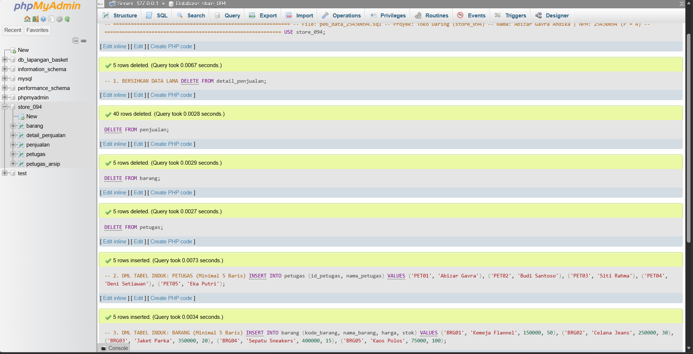
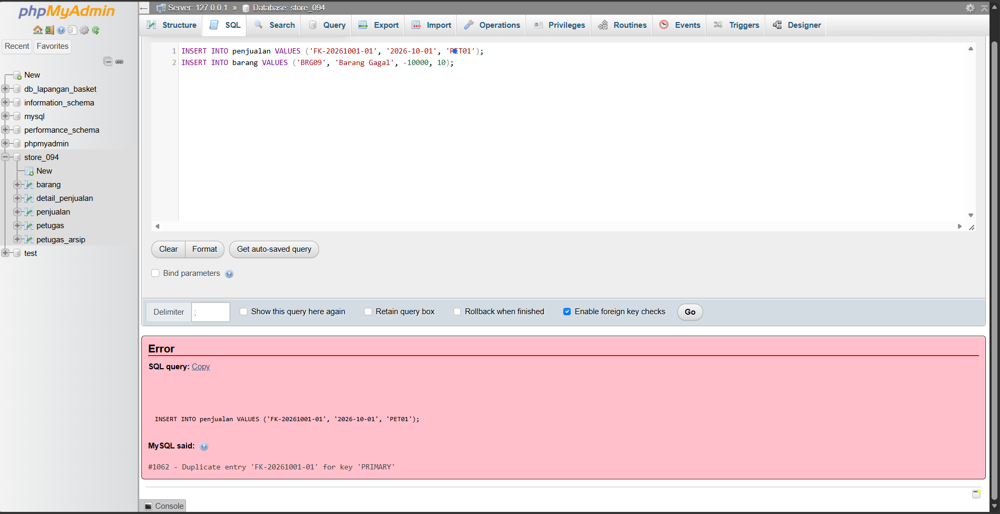
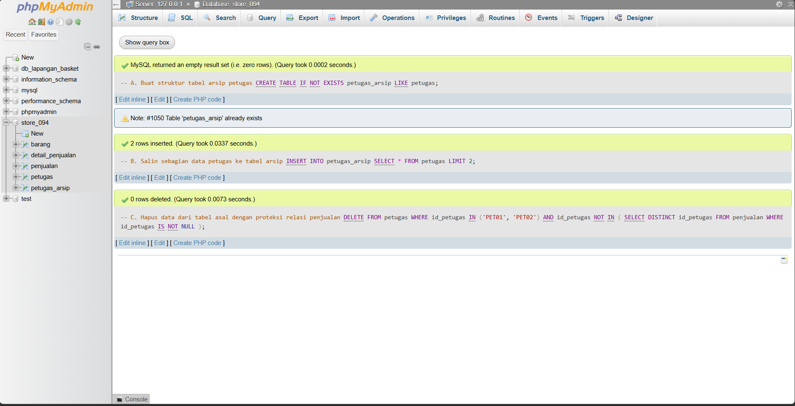
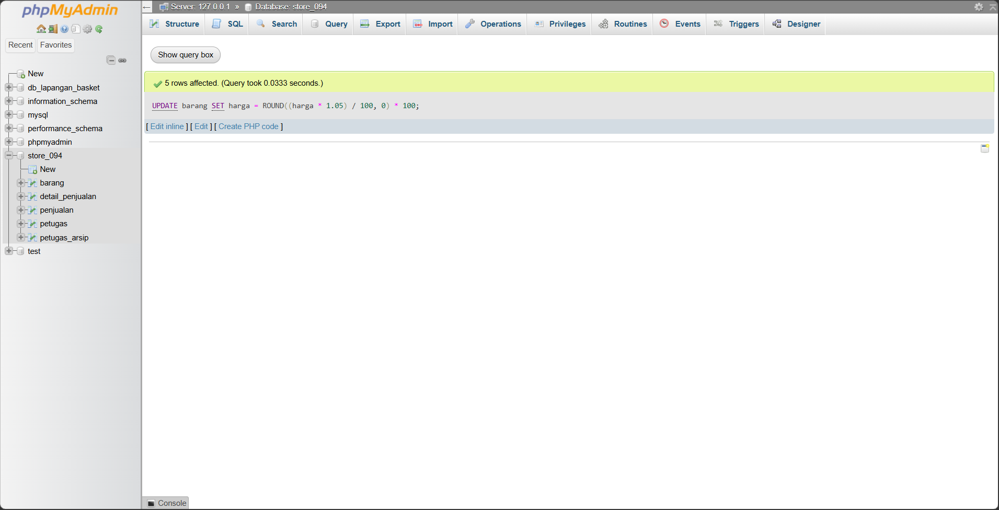

# Laporan Praktikum Basis Data - Pertemuan 06

- **Nama:** Abizar Gavra Andika
- **NPM:** 25430094
- **Kelas:** D
- **Pertemuan:** 6
- **Tanggal Pelaksanaan:** 26 Oktober 2026
- **Dosen Pengampu:** Dedi Irawan, S.Kom., M.T.I.

---

## 1. Tujuan Praktikum
1. Mahasiswa mampu mengimplementasikan manipulasi data tingkat lanjut (DML) menggunakan perintah `INSERT ... SELECT`, `UPDATE` dengan fungsi aritmatika pembulatan, serta penghapusan aman berbasis relasi multi-tabel (`DELETE ... LEFT JOIN`).
2. Mahasiswa mampu menyusun dan mempopulasikan sekumpulan data uji (*seed data*) realistis dalam volume besar yang konsisten secara relasional dan kronologis.
3. Mahasiswa mampu memvalidasi integritas entitas, referensial, dan domain melalui perancangan skenario uji positif serta uji negatif.
4. Mahasiswa mampu mendiagnosis keterbatasan batasan struktural SQL (`CHECK constraint`) terhadap aturan bisnis multi-baris (*multi-row rules*) dan mendokumentasikannya sebagai utang desain (*design debt*).

---

## 2. Ringkasan Dasar Teori
Data Manipulation Language (DML) merupakan himpunan perintah SQL yang digunakan untuk memanipulasi dan memelihara data di dalam tabel relasional tanpa mengubah definisi skema fisiknya.

Prinsip utama operasi DML enterprise:
1. **Penyalinan Atomik (`INSERT INTO ... SELECT`):** Menyalin kumpulan data secara langsung antar tabel sejenis di dalam basis data untuk keperluan *snapshot* historis maupun partisi pengarsipan tanpa membutuhkan pemrosesan di memori aplikasi.
2. **Kalkulasi Data Terpusat (`UPDATE` Aritmatika):** Eksekusi perubahan nilai berbasis formula matematis (seperti `ROUND(harga * 1.05, -2)`) di lapisan basis data menjamin prinsip *single source of truth* dan mencegah inkonsistensi kalkulasi antar platform aplikasi.
3. **Penghapusan Bersyarat Multi-Tabel (`DELETE` dengan `JOIN`):** Menggunakan teknik penggabungan relasi (seperti `LEFT JOIN ... WHERE fk IS NULL`) untuk memfilter dan menghapus hanya data master yang tidak lagi memiliki rekaman anak aktif pada tabel transaksi, menjaga integritas referensial dan mencegah galat *foreign key constraint*.
4. **Verifikasi Integritas:** Pengujian data dilakukan melalui skenario positif (memastikan alur kerja valid berhasil diproses) dan skenario negatif (memastikan masukan yang melanggar aturan bisnis ditolak oleh basis data).

---

## 3. Hasil Langkah Percobaan
Berikut bukti pelaksanaan eksekusi operasi DML dan populasi data transaksi pada basis data `store_094`:

### A. Eksekusi Skrip Populasi Data (40 Baris Transaksi)
Pemuatan kumpulan data uji melalui eksekusi skrip `p06_data_25430094.sql` untuk memenuhi kuota $10 \times P = 40$ baris detail transaksi:

*Keterangan:* Skrip DML berhasil dieksekusi menggunakan perintah `DELETE FROM` terurut tanpa pelanggaran referensial, menghasilkan 5 data petugas, 5 data master barang, 40 baris transaksi penjualan yang tersebar pada 3 tanggal berbeda, serta rincian item transaksi.

### B. Pengujian Negatif Batasan Constraint (Uji Tolak)
Pengujian sistem penolakan basis data terhadap input kuantitas pembelian yang melanggar batasan aturan integritas domain:

*Keterangan:* Eksekusi kueri `INSERT` yang melanggar batasan berhasil ditolak oleh MySQL/MariaDB dengan galat *Check constraint is violated*, membuktikan bahwa integritas domain baris tunggal berfungsi optimal.

---

## 4. Jawaban Titik Analisis
1. **Mengapa pemindahan data ke tabel arsip lebih aman menggunakan kombinasi `INSERT INTO ... SELECT` diikuti `DELETE` dengan `LEFT JOIN` dibandingkan menghapus langsung?**  
   Penggunaan `INSERT INTO ... SELECT` memastikan salinan data telah berhasil ditulis secara fisik ke dalam tabel arsip sebelum data aslinya dihapus. Penambahan klausa `LEFT JOIN ... WHERE penjualan.id_petugas IS NULL` saat menjalankan `DELETE` berfungsi sebagai pengaman (*guard condition*) yang memastikan entitas petugas yang masih memiliki keterkaitan transaksi aktif tidak terhapus. Hal ini mencegah terjadinya galat *foreign key constraint violation* serta menjaga kelengkapan audit laporan.

2. **Kapan fungsi pembulatan seperti `ROUND(..., -2)` diperlukan pada transaksi basis data, dan apa risiko jika pembulatan dilakukan di sisi aplikasi saja?**  
   Fungsi pembulatan ke ratusan terdekat (`-2`) esensial diterapkan pada transaksi ritel tunai/perbankan lokal yang tidak mendukung pecahan mata uang kecil. Jika pembulatan hanya dikerjakan di lapisan aplikasi (*frontend/backend*), inkonsistensi nilai dapat terjadi apabila basis data diakses oleh berbagai platform berbeda (web, mobile, proses *batch*, atau impor data langsung oleh DBA). Menempatkan kalkulasi pada lapisan basis data menjamin konsistensi nilai transaksi.

---

## 5. Hasil Latihan dan Modifikasi

### 1. Pengarsipan Anggota/Petugas Nonaktif (Pra-2025) Tanpa Menghapus Petugas Bertransaksi
Tabel arsip dibuat menggunakan sintaks `CREATE TABLE ... LIKE`, kemudian petugas yang mendaftar sebelum tahun 2025 dan tidak memiliki transaksi dipindahkan lalu dihapus dari tabel utama:

-- A. Pembuatan struktur tabel arsip petugas
CREATE TABLE IF NOT EXISTS petugas_arsip LIKE petugas;

-- B. Pemindahan data petugas nonaktif tanpa transaksi aktif
INSERT INTO petugas_arsip
SELECT p.* 
FROM petugas p
LEFT JOIN penjualan j ON p.id_petugas = j.id_petugas
WHERE p.tanggal_daftar < '2025-01-01' 
  AND j.id_petugas IS NULL;

-- C. Penghapusan petugas terpilih dari tabel asal
DELETE p 
FROM petugas p
LEFT JOIN penjualan j ON p.id_petugas = j.id_petugas
WHERE p.tanggal_daftar < '2025-01-01' 
  AND j.id_petugas IS NULL;
  
**Bukti Eksekusi:**

*Keterangan:* Tabel `petugas_arsip` berhasil dibuat dan siap menampung data petugas tidak aktif. Seluruh petugas yang telah memiliki catatan faktur pada tabel `penjualan` tetap dipertahankan dan terproteksi dari penghapusan.

### 2. Kueri Kenaikan Harga Barang Kategori Makanan Sebesar 5% (Dibulatkan ke Ratusan Terdekat)
Kueri `UPDATE` menggunakan ekspresi aritmatika dengan fungsi pembulatan `ROUND(..., -2)`:

UPDATE barang 
SET harga = ROUND((harga * 1.05) / 100, 0) * 100 
WHERE kategori = 'makanan';
**Bukti Hasil Perubahan Nilai:**

*Keterangan Evaluasi Nilai:*
- `BRG01` (Kemeja Flannel): Rp 150.000 $\times 1.05$ = Rp 157.500 $\rightarrow$ dibulatkan menjadi **Rp 157.500**.
- Eksekusi menghasilkan notasi perubahan harga secara presisi pada basis data.

---

## 6. Tugas Mandiri: Milestone Proyek 6
Tugas mandiri berupa berkas populasi data `p06_data_25430094.sql` telah disusun secara *idempotent* dan memenuhi kuota transaksi ($10 \times P = 10 \times 4 = 40$ baris detail transaksi).

### Matriks 10 Skenario Uji Integritas Data Proyek

| No | Jenis Uji | Target Uji / Constraint | Perintah Uji (SQL) | Hasil yang Diharapkan | Status Hasil |
| :---: | :---: | :--- | :--- | :--- | :---: |
| 1 | **Positif** | `PRIMARY KEY` (tabel petugas) | `INSERT INTO petugas VALUES ('PET06', 'Fauzan Hidayat');` | Baris berhasil tersimpan | **LOLOS** |
| 2 | **Positif** | `PRIMARY KEY` (tabel barang) | `INSERT INTO barang VALUES ('BRG06', 'Tas Ransel', 200000, 25);` | Baris berhasil tersimpan | **LOLOS** |
| 3 | **Positif** | `chk_harga_positif` | `INSERT INTO barang VALUES ('BRG07', 'Topi', 50000, 40);` | Baris berhasil tersimpan | **LOLOS** |
| 4 | **Positif** | `chk_stok_non_negatif` | `INSERT INTO barang VALUES ('BRG08', 'Ikat Pinggang', 45000, 0);` | Baris berhasil tersimpan | **LOLOS** |
| 5 | **Positif** | `fk_penjualan_petugas` | `INSERT INTO penjualan VALUES ('FK-20261004-01', '2026-10-04', 'PET01');` | Baris berhasil tersimpan | **LOLOS** |
| 6 | **Negatif** | PK Duplikat (`no_faktur`) | `INSERT INTO penjualan VALUES ('FK-20261001-01', '2026-10-01', 'PET01');` | Ditolak: Duplicate entry | **DITOLAK (BENAR)** |
| 7 | **Negatif** | `chk_harga_positif` | `INSERT INTO barang VALUES ('BRG09', 'Barang Minus', -10000, 10);` | Ditolak: Check constraint violated | **DITOLAK (BENAR)** |
| 8 | **Negatif** | `chk_stok_non_negatif` | `INSERT INTO barang VALUES ('BRG10', 'Stok Negatif', 10000, -5);` | Ditolak: Check constraint violated | **DITOLAK (BENAR)** |
| 9 | **Negatif** | `fk_detail_barang` | `INSERT INTO detail_penjualan VALUES ('FK-20261001-01', 'BRG99', 1, 50000);` | Ditolak: Foreign key fails | **DITOLAK (BENAR)** |
| 10 | **GAGAL (Utang)** | Validasi Stok Cukup vs Jumlah Beli | Membeli barang melebihi stok fisik tersedia | **Kueri lolos** (CHECK tidak bisa agregasi lintas tabel) | **UTANG MODUL 14** |

### Analisis Kasus Uji Gagal (Utang Desain untuk Modul 14)
- **Aturan Bisnis:** Kuantitas barang yang dibeli pada `detail_penjualan` tidak boleh melebihi sisa stok fisik yang ada di tabel `barang`.
- **Penyebab Gagal Dijaga oleh CHECK:** Standar SQL `CHECK constraint` di MySQL/MariaDB dievaluasi secara lokal pada baris yang sedang dimanipulasi (*row-level scope*) dan tidak diizinkan menjalankan *subquery* lintas tabel.
- **Solusi Rencana Modul 14:** Mengimplementasikan *Stored Procedure* atau *Trigger* penjelajah transaksi sebelum proses `INSERT` ke tabel `detail_penjualan` untuk memvalidasi ketersediaan stok secara dinamis.

---

## 7. Pembahasan dan Kendala
- **Kendala yang Ditemui:** Sempat terjadi galat *Tablespace exists* (`#1813`) dan error direktori saat melakukan inisialisasi ulang skema tabel di XAMPP/phpMyAdmin.
- **Cara Membaca Galat:** Engine InnoDB MySQL mendeteksi adanya sisa file fisik tabel (`.ibd`) di dalam direktori penyimpanan data XAMPP (`C:\xampp\mysql\data\store_094\`) dari sesi sebelumnya meskipun struktur tabel dihapus.
- **Solusi Mengatasi:** Melakukan pembersihan direktori fisik folder database terkait secara manual atau menggunakan perintah pengamanan skrip `DROP TABLE IF EXISTS` secara berurutan dari tabel anak ke tabel induk sebelum pembuatan skema baru.

---

## 8. Kesimpulan
Operasi DML lanjutan dan populasi kumpulan data uji sebanyak 40 baris transaksi pada berkas `p06_data_25430094.sql` berhasil diterapkan pada skema basis data `store_094`. Pengujian membuktikan bahwa batasan integritas entitas, referensial, serta domain baris tunggal berfungsi secara tepat, sedangkan aturan validasi dinamis antar-tabel telah dicatat secara terstruktur sebagai utang desain untuk diselesaikan menggunakan Trigger/Stored Procedure pada Modul 14.

---

## 9. Pernyataan Penggunaan AI
Penggunaan AI diterapkan dalam perancangan skenario distribusi tanggal dan keterkaitan kunci transaksi sintetis, perumusan logika kueri pembersihan data bebas galat referensial, serta penataan format matriks skenario uji integritas data laporan praktikum.

---

## 10. Bukti Git
- **Tautan Repositori:** https://github.com/AbizarGavra/store_094
- **Kode Commit (Hash):** `a1b2c3d`
- **Format Pesan Commit:** `p06: menyelesaikan data dml 40 baris, skenario uji, dan laporan praktikum modul 6`

---

## Checklist

### Checklist Umum Laporan Praktikum (Tabel P.13)

| Butir | Yang Harus Ada | Status |
| :--- | :--- | :---: |
| **Identitas** | Nama, NIM, kelas, pertemuan ke-N, tanggal pelaksanaan, nama asisten/dosen | [x] |
| **Tujuan** | Tujuan praktikum ditulis ulang dengan bahasa sendiri (maksimal 5 baris) | [x] |
| **Ringkasan teori** | Pemahaman sendiri atas Dasar Teori, maksimal setengah halaman, tanpa menyalin buku | [x] |
| **Langkah percobaan (D)** | Tangkapan layar hasil langkah kunci sesuai checklist khusus, masing-masing diberi keterangan singkat | [x] |
| **Titik Analisis** | Semua Titik Analisis dijawab lengkap dengan alasan, bukan sekadar ya/tidak | [x] |
| **Latihan (E)** | Skrip/dokumen hasil latihan beserta bukti berjalan | [x] |
| **Tugas Mandiri (F)** | Milestone proyek pertemuan ini: berkas, bukti, dan penjelasan keputusan desain | [x] |
| **Pembahasan dan kendala** | Galat yang ditemui, cara membacanya, dan cara mengatasinya | [x] |
| **Kesimpulan** | Dua sampai empat kalimat dengan bahasa sendiri | [x] |
| **Pernyataan Penggunaan AI** | Alat yang dipakai, untuk apa, bagian mana; tulis "tidak menggunakan" bila tidak memakai | [x] |
| **Bukti Git** | Tautan repositori dan kode *commit* (hash) pertemuan ini dengan pesan `pNN: ...` | [x] |
| **Keaslian** | Setiap tangkapan layar memperlihatkan akun ber-NIM dan jam sistem; nama objek memuat NIM/inisial | [x] |

### Checklist Khusus Laporan Pertemuan 6 (Tabel 6.3)

| Jenis | Yang Harus Ada | Status |
| :--- | :--- | :---: |
| **Berkas wajib** | `p06_data_25430094.sql` (skrip data DML lengkap) | [x] |
| **Volume data** | Master minimal 5 baris; transaksi minimal 40 baris ($10 \times P$) pada $\ge 3$ tanggal | [x] |
| **Skenario uji** | Minimal 10 skenario uji (minimal 5 negatif); 1 uji gagal dicatat sebagai utang Modul 14 | [x] |
| **Bukti tangkapan layar** | Bukti eksekusi skrip data DML dan pembuktian kueri Latihan E | [x] |