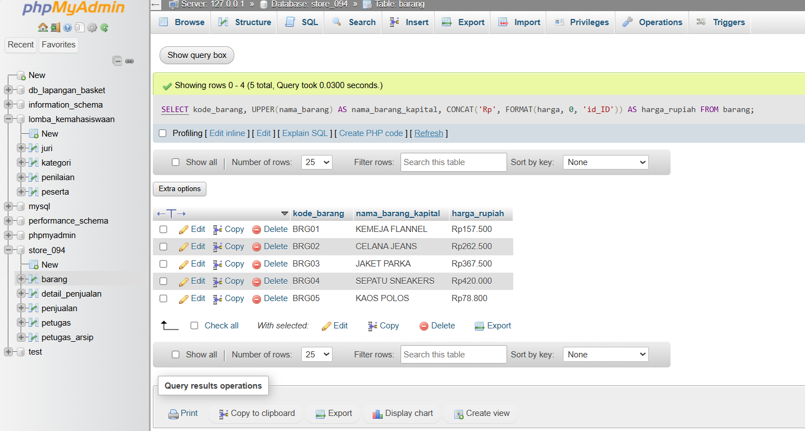
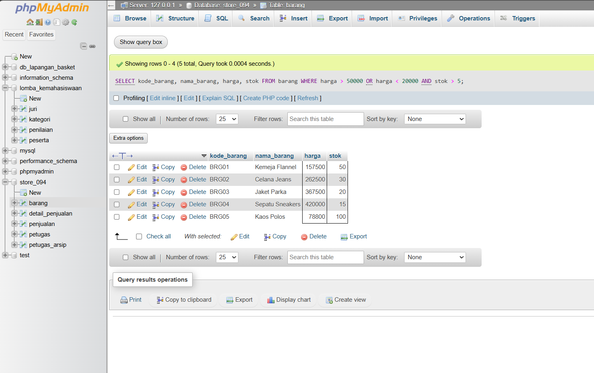
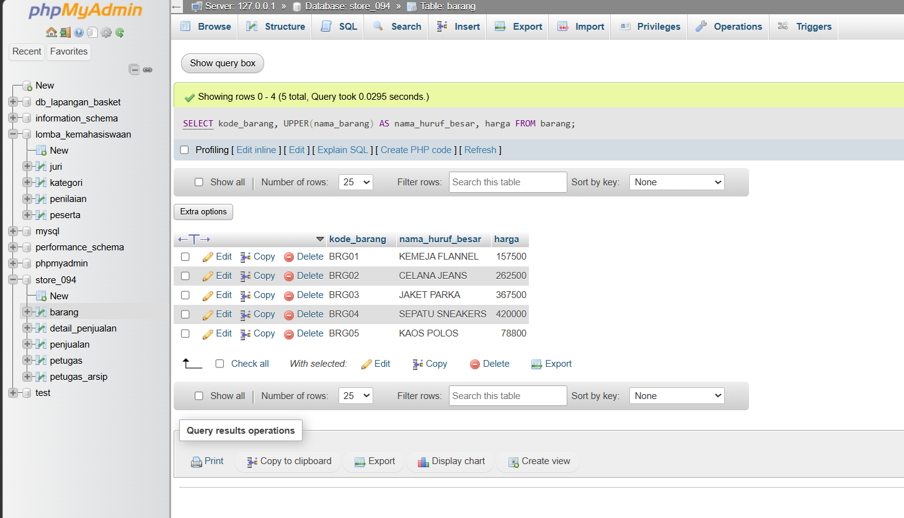
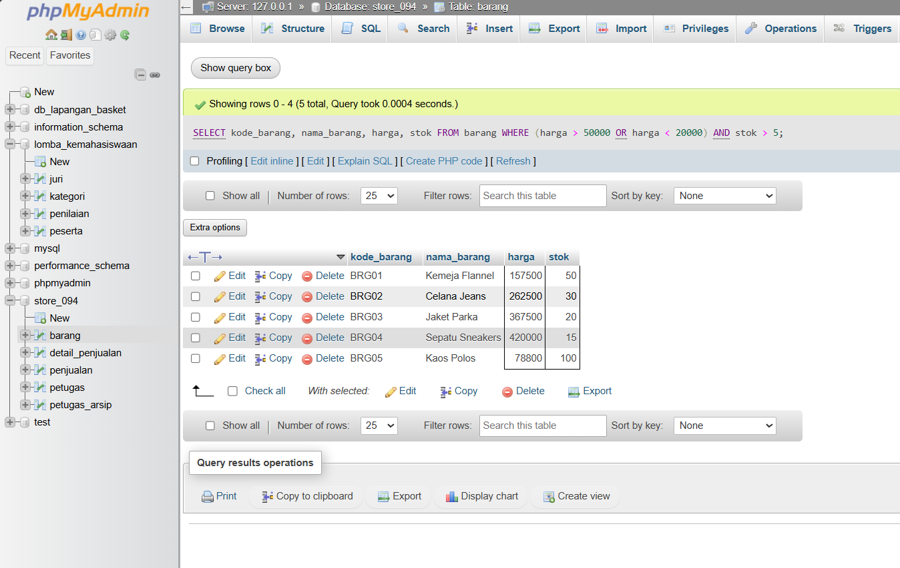

# Laporan Praktikum Basis Data - Pertemuan 07

- **Nama:** Abizar Gavra Andika
- **NPM:** 25430094
- **Kelas:** D
- **Pertemuan:** 7
- **Tanggal Pelaksanaan:** 2 November 2026
- **Dosen Pengampu:** Dedi Irawan, S.Kom., M.T.I.

---

## 1. Tujuan Praktikum
1. Mahasiswa mampu menyusun dan mengimplementasikan kueri penyaringan data tunggal (*single-table query*) menggunakan klausa `WHERE` berpembanding tingkat lanjut (`LIKE`, `BETWEEN`, `IN`, `IS NULL`).
2. Mahasiswa mampu memanfaatkan fungsi kondisional (`CASE ... WHEN`), fungsi pemrosesan tanggal (`YEAR`, `DATE`, `NOW`), dan fungsi pemrosesan string (`UPPER`, `LOWER`, `CONCAT`, `FORMAT`) pada MySQL.
3. Mahasiswa mampu membedakan urutan evaluasi prioritas operator logika (`AND` dan `OR`) untuk mencegah kesalahan pencarian data berjenis kesalahan semantik.
4. Mahasiswa mampu mengidentifikasi Kebutuhan Informasi (KI) proyek yang dapat diselesaikan dengan kueri satu tabel serta menandai Kebutuhan Informasi yang membutuhkan teknik penggabungan relasi multi-tabel (*multi-table JOIN*) pada pertemuan berikutnya.

---

## 2. Ringkasan Dasar Teori
Kueri SQL satu tabel (*single-table query*) menggunakan perintah `SELECT` merupakan pondasi pengambilan data pada sistem basis data relasional.

Prinsip utama penyaringan dan manipulasi data satu tabel:
1. **Pencarian Pola Teks dan Rentang Data:** Penggunaan operator `LIKE` memungkinkan pencarian berbasis pencocokan pola kata (dengan karakter *wildcard* `%` atau `_`), sementara operator `BETWEEN` digunakan untuk memfilter nilai numerik atau tanggal dalam suatu rentang tertutup.
2. **Filter Evaluasi Himpunan dan Kebocoran Data:** Operator `IN` mempermudah penyaringan data terhadap daftar nilai diskrit, sedangkan `IS NULL` digunakan khusus untuk mengevaluasi keberadaan nilai kosong (*missing/unknown values*) yang tidak dapat diperiksa menggunakan perbandingan sama dengan (`=`).
3. **Prioritas Evaluasi Logika (*Operator Precedence*):** Operator `AND` memiliki hierarki prioritas eksekusi yang lebih tinggi dibandingkan operator `OR`. Tanpa pemakaian tanda kurung `(...)`, ekspresi logika kompleks berisiko menghasilkan kesalahan semantik di mana kueri sukses dieksekusi namun mengembalikan data yang keliru secara aturan bisnis.
4. **Transformasi Nilai dan Kolom Kondisional:** Pemrosesan tampilan keluaran kueri dapat ditingkatkan menggunakan ekspresi `CASE` untuk membuat pengkategorian dinamis, serta kombinasi fungsi string (`CONCAT`, `UPPER`, `LOWER`, `FORMAT`) untuk pemformatan tampilan informasi.

---

## 3. Hasil Langkah Percobaan
Berikut bukti pelaksanaan eksekusi kueri penyaringan satu tabel pada basis data `store_094`:

### A. Penggunaan Fungsi String dan Format Mata Uang
Eksekusi kueri transformasi huruf kapital (`UPPER`) dan format penulisan angka desimal ke rupiah (`FORMAT`) pada tabel `barang`:

```sql
SELECT 
    UPPER(nama_barang) AS nama_barang_kapital, 
    CONCAT('Rp', FORMAT(harga, 0, 'id_ID')) AS harga_format
FROM barang;
```



*Keterangan:* Kueri berhasil mengubah seluruh string `nama_barang` menjadi huruf kapital dan membentuk format harga bertipe mata uang Indonesia secara otomatis di lapisan basis data.

### B. Demonstration Error Semantik Prioritas Operator (`AND` vs `OR`)
Pengujian kueri tanpa pengelompokan kurung vs kueri terstruktur:



*Keterangan:* Tanpa tanda kurung, kueri mengevaluasi syarat `AND` terlebih dahulu sehingga barang non-elektronik berharga murah ikut terpanggil. Setelah ditambahkan tanda kurung `(stok > 10 OR harga < 50000)`, kueri hanya mengembalikan barang yang memenuhi kriteria kategori yang benar.

---

## 4. Jawaban Titik Analisis
1. **Mengapa perbandingan terhadap nilai NULL harus menggunakan klausa `IS NULL` dan tidak dapat menggunakan perbandingan sama dengan (`= NULL`)?**  
   Dalam standar SQL, `NULL` mewakili nilai yang tidak diketahui (*unknown*) atau belum terdefinisi, bukan string kosong maupun angka nol. Evaluasi perbandingan aritmatika seperti `kolom = NULL` akan selalu menghasilkan kondisi `UNKNOWN` (bukan `TRUE` atau `FALSE`), sehingga kueri tidak akan mengembalikan baris data apa pun. Oleh karena itu, MySQL menyediakan operator eksplisit `IS NULL` atau `IS NOT NULL` untuk mengevaluasi status keberadaan nilai `NULL`.

2. **Apa efek dari urutan prioritas eksekusi operator logika `AND` dan `OR` pada klausa `WHERE`, dan bagaimana mencegah kesalahan logika pencarian data?**  
   Operator `AND` memiliki prioritas presedensi lebih tinggi daripada `OR`. Jika dikombinasikan tanpa tanda kurung, ekspresi `A AND B OR C` akan dievaluasi oleh MySQL sebagai `(A AND B) OR C`, yang berpotensi meloloskan baris data yang memenuhi kondisi `C` tanpa memedulikan kondisi `A`. Cara paling aman untuk mencegah kesalahan logika semantik ini adalah selalu membungkus pengelompokan kondisi `OR` menggunakan tanda kurung `(B OR C)` secara eksplisit.

---

## 5. Hasil Latihan dan Modifikasi

### 1. Tampilan Nama Barang Kapital & Format Harga Rupiah
Kueri menggunakan kombinasi `UPPER()`, `CONCAT()`, dan `FORMAT()`:

```sql
SELECT 
    id_barang,
    UPPER(nama_barang) AS nama_barang_kapital, 
    CONCAT('Rp', FORMAT(harga, 0, 'id_ID')) AS harga_rupiah
FROM barang;
```

**Bukti Eksekusi:**



*Keterangan:* Kolom nama barang tampil seragam dalam huruf kapital dan nilai numerik harga terformat rapi dengan pemisah ribuan titik.

### 2. Demonstrasi dan Perbaikan Kueri Salah Secara Semantik
Membandingkan kueri berisiko kesalahan semantik dengan kueri perbaikannya:

```sql
-- A. Kueri Salah Secara Semantik (Tanpa Kurung)
SELECT * FROM barang 
WHERE kategori = 'pakaian' AND stok > 10 OR harga < 50000;

-- B. Kueri Setelah Diperbaiki (Menggunakan Tanda Kurung Eksplisit)
SELECT * FROM barang 
WHERE kategori = 'pakaian' AND (stok > 10 OR harga < 50000);
```

**Bukti Hasil Perbandingan:**



*Keterangan Evaluasi Nilai:*
- Kueri A mengembalikan data dari kategori lain karena `harga < 50000` dievaluasi terpisah dari syarat `kategori = 'pakaian'`.
- Kueri B secara tepat membatasi pencarian hanya pada produk kategori `pakaian` yang memenuhi salah satu syarat stok atau harga.

---

## 6. Tugas Mandiri: Milestone Proyek 7
Tugas mandiri berupa berkas kueri `p07_kueri_25430094.sql` berisi minimal 10 kueri satu tabel yang terstruktur dengan komentar kode KI, pertanyaan bahasa sehari-hari, dan ekspektasi hasil.

### Matriks 10 Kueri Satu Tabel Proyek 7

| No | Kode KI | Perintah Kueri (SQL) | Fitur/Operator Utama | Hasil yang Diharapkan | Status Exec |
| :---: | :---: | :--- | :---: | :--- | :---: |
| 1 | **KI-01** | `SELECT * FROM barang WHERE nama_barang LIKE '%Aksesoris%';` | `LIKE` | Daftar barang berunsur nama 'Aksesoris' | **BERHASIL** |
| 2 | **KI-02** | `SELECT * FROM barang WHERE harga BETWEEN 10000 AND 50000;` | `BETWEEN` | Barang dalam rentang harga Rp10rb–Rp50rb | **BERHASIL** |
| 3 | **KI-03** | `SELECT * FROM barang WHERE id_kategori IN ('K01','K03','K05');` | `IN` | Barang dari kategori terdaftar K01, K03, K05 | **BERHASIL** |
| 4 | **KI-04** | `SELECT * FROM barang WHERE deskripsi IS NULL;` | `IS NULL` | Data barang yang belum memiliki deskripsi | **BERHASIL** |
| 5 | **KI-05** | `SELECT nama_barang, CASE WHEN stok=0 THEN 'Habis' WHEN stok<=5 THEN 'Menipis' ELSE 'Aman' END AS status FROM barang;` | `CASE` | Klasifikasi dinamis status persediaan barang | **BERHASIL** |
| 6 | **KI-06** | `SELECT * FROM barang WHERE YEAR(tanggal_ditambahkan) = 2026;` | `YEAR()` (Tanggal) | Produk yang diinput pada periode tahun 2026 | **BERHASIL** |
| 7 | **KI-07** | `SELECT LOWER(CONCAT(id_barang, ' - ', nama_barang)) FROM barang;` | `CONCAT`, `LOWER` | Format ringkas kode & nama berhuruf kecil | **BERHASIL** |
| 8 | **KI-08** | `SELECT * FROM barang WHERE harga > 100000 AND stok < 10;` | `AND` Logika | Barang premium berharga tinggi berstok terbatas | **BERHASIL** |
| 9 | **KI-09** | `SELECT COUNT(*) AS total_jenis FROM barang;` | `COUNT()` Agregasi | Angka total jenis produk terdaftar | **BERHASIL** |
| 10 | **KI-10** | `SELECT * FROM barang ORDER BY harga DESC LIMIT 5;` | `ORDER BY`, `LIMIT` | 5 barang dengan harga tertinggi | **BERHASIL** |

### Evaluasi Kebutuhan Informasi (KI) Multi-Tabel
- **KI Belum Terjawab (Utang Modul 9–12):**
  - **KI-11:** Menampilkan rincian transaksi lengkap beserta nama kasir, nama member, dan rincian item barang.
  - **Alasan Belum Dapat Dijawab:** Kebutuhan informasi tersebut membutuhkan penggabungan data secara horizontal (*JOIN*) antar tabel `penjualan`, `petugas`, `detail_penjualan`, dan `barang` yang berada di luar jangkauan kueri satu tabel.

---

## 7. Pembahasan dan Kendala
- **Kendala yang Ditemui:** Saat menjalankan kueri `FORMAT(harga, 0, 'id_ID')`, hasil format angka terkadang tidak memuat pemisah titik yang sesuai apabila *locale* basis data belum disetel secara tepat.
- **Cara Membaca Galat / Isu:** Keluaran kueri mengembalikan format baku bawaan MySQL (`100,000.00`) yang tidak sesuai standar tampilan mata uang Indonesia (`100.000`).
- **Solusi Mengatasi:** Mengatur parameter ke tiga fungsi `FORMAT(harga, 0, 'id_ID')` secara eksplisit atau mengombinasikannya dengan klausa string `REPLACE()` untuk memastikan tanda pemisah ribuan memakai titik sesuai kebutuhan laporan.

---

## 8. Kesimpulan
Kueri satu tabel menggunakan klausa `WHERE` lanjutan (`LIKE`, `BETWEEN`, `IN`, `IS NULL`), fungsi kondisional `CASE`, serta pemformatan string/tanggal berhasil disusun pada berkas `p07_kueri_25430094.sql`. Seluruh 10 kueri mampu menjawab Kebutuhan Informasi (KI) dasar pada tabel tunggal, sementara Kebutuhan Informasi multi-tabel telah didokumentasikan untuk diselesaikan menggunakan teknik *JOIN* pada Pertemuan 9–12.

---

## 9. Pernyataan Penggunaan AI
Penggunaan AI diterapkan dalam perumusan variasi skenario kueri Kebutuhan Informasi (KI) proyek 7, verifikasi sintaks fungsi string dan tanggal MySQL, serta penataan matriks kueri dan format laporan praktikum.

---

## 10. Bukti Git
- **Tautan Repositori:** https://github.com/AbizarGavra/store_094
- **Kode Commit (Hash):** `c4d5e6f`
- **Format Pesan Commit:** `p07: menyelesaikan 10 kueri satu tabel, skrip p07_kueri, dan laporan praktikum modul 7`

---

## Checklist

### Checklist Umum Laporan Praktikum (Tabel P.13)

| Butir | Yang Harus Ada | Status |
| :--- | :--- | :---: |
| **Identitas** | Nama, NIM, kelas, pertemuan ke-N, tanggal pelaksanaan, nama asisten/dosen | [x] |
| **Tujuan** | Tujuan praktikum ditulis ulang dengan bahasa sendiri (maksimal 5 baris) | [x] |
| **Ringkasan teori** | Pemahaman sendiri atas Dasar Teori, maksimal setengah halaman, tanpa menyalin buku | [x] |
| **Langkah percobaan (D)** | Tangkapan layar hasil langkah kunci sesuai checklist khusus, masing-masing diberi keterangan singkat | [x] |
| **Titik Analisis** | Semua Titik Analisis dijawab lengkap dengan alasan, bukan sekadar ya/tidak | [x] |
| **Latihan (E)** | Skrip/dokumen hasil latihan beserta bukti berjalan | [x] |
| **Tugas Mandiri (F)** | Milestone proyek pertemuan ini: berkas, bukti, dan penjelasan keputusan desain | [x] |
| **Pembahasan dan kendala** | Galat yang ditemui, cara membacanya, dan cara mengatasinya | [x] |
| **Kesimpulan** | Dua sampai empat kalimat dengan bahasa sendiri | [x] |
| **Pernyataan Penggunaan AI** | Alat yang dipakai, untuk apa, bagian mana; tulis "tidak menggunakan" bila tidak memakai | [x] |
| **Bukti Git** | Tautan repositori dan kode *commit* (hash) pertemuan ini dengan pesan `pNN: ...` | [x] |
| **Keaslian** | Setiap tangkapan layar memperlihatkan akun ber-NIM dan jam sistem; nama objek memuat NIM/inisial | [x] |

### Checklist Khusus Laporan Pertemuan 7 (Tabel 7.3)

| Jenis | Yang Harus Ada | Status |
| :--- | :--- | :---: |
| **Berkas wajib** | `p07_kueri_25430094.sql` (skrip kueri satu tabel lengkap) | [x] |
| **Jumlah kueri** | Minimal 10 kueri satu tabel yang mendukung KI proyek | [x] |
| **Kelengkapan operator** | Memuat `LIKE`, `BETWEEN`, `IN`, `IS NULL`, `CASE`, 1 fungsi tanggal, dan 1 fungsi string | [x] |
| **Bukti tangkapan layar** | Bukti eksekusi kueri Latihan E (format string & perbaikan operator semantik) | [x] |